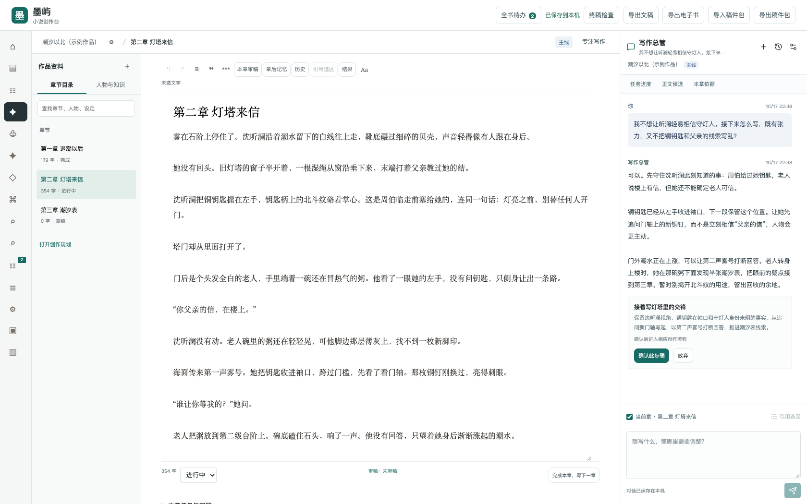
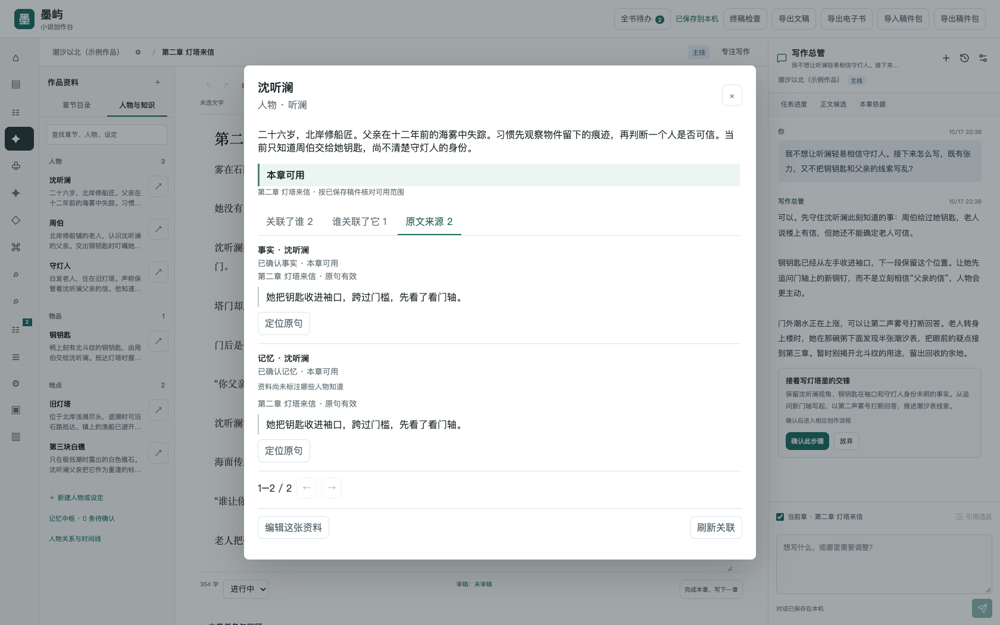

<div align="center">


# 墨屿

**和写作总管一起，把故事写成长篇。**

面向中文长篇小说的电脑创作软件。让正文、人物、伏笔与原文依据，在同一个工作台里连起来。

<p>
  
  
  
  
</p>

[界面预览](#界面预览) · [创作流程](#创作流程) · [一致性检查](#一致性检查) · [开始使用](#开始使用) · [文档导航](#文档导航)

</div>

<br>

## 界面预览



<p align="center"><sub>真实运行界面 · 原创示例作品 · 电脑端</sub></p>

目录、正文与写作总管同屏。切换资料或规划时，对话继续保留；需要比较候选、确认记忆时，再展开对应工作区。

## 写长篇，需要一个记得住来路的工作台

人物越来越多，伏笔跨了十几章，改一段正文还要回头核对设定。墨屿把这些工作放到一起：你专注故事，写作总管帮你讨论、安排任务、找回资料，并接续章后记忆与审稿。

### 随时能聊，也能把讨论接进创作

写作总管常驻主界面。结合作品资料讨论灵感、人物和情节，也可以带上当前章节或选中的原文，继续追问和复制回复。满意的构思确认后保存到设定库，标记为尚未发生的作者计划。需要行动时，建议会进入原聊天中的任务卡；确认计划并启动任务后，接续续写、修订、规划或检查，进度与结果都能回看。

### 资料有关联，记忆可追溯

人物、地点、物品、关系和伏笔组成作品自己的知识库。关联与回链让线索彼此连通，来自正文的已确认记忆保留来源章节和原句。改稿后，失效的依据会提示重新核对；后续写作使用已确认、在当前章节可用的资料。



<p align="center"><sub>从一张资料卡，查看关联、回链与原句依据。</sub></p>

### 让每一次改稿都有余地

续写和润色先生成候选，比较后再采纳；局部修改只作用于所选原文。正文保留历史版本，模型生成的资料由作者确认后进入正式记忆。故事的关键决定始终留在你手里。

## 创作流程

**故事设定 → 创作规划 → 正文候选 → 记忆确认 → 故事审稿 → 下一章**

1. **把故事说清楚。** 从一句话设定、主角与眼前的阻力开始，建立第一章；需要长线规划时，按总纲、分卷、章节、场景逐步展开。
2. **和总管一起写。** 在主界面讨论、引用原文、生成续写或修订候选，比较后采纳到稿件。
3. **让故事留下记忆。** 确认本章回顾、新事实和下一章任务，再处理审稿中发现的问题；总管按已授权的流程接续。
4. **接着写，直到收尾。** 完成本章后承接下一章。交稿前运行终稿检查，再导出文稿或电子书。

## 你会用到的能力

| 创作中的事情 | 墨屿怎样帮你 |
| --- | --- |
| 管好一部长篇 | 多作品书架，卷、章、场景规划，章节任务卡与写作进度 |
| 随时讨论与安排任务 | 灵感讨论与确认保存、常驻总管对话、当前章与选区引用、任务进度与结果直达 |
| 保持人物与情节连贯 | 关联知识卡、章后记忆、原句证据、人物关系、时间线与伏笔 |
| 保持全书前后一致 | 七类一致性检查、证据定位、分数与等级、发表门禁 |
| 放心尝试不同写法 | 选区润色、候选比较、明确采纳、正文历史与版本恢复 |
| 为不同工作选择模型 | 自动获取模型清单，支持 Chat / Responses；先测试保存，再为创作各用途分配模型 |
| 留住并带走作品 | 本机保存、完整作品 ZIP 备份与独立恢复、Markdown 文稿和 EPUB 电子书导出 |

## 一致性检查

墨屿的一致性引擎对当前作品的故事状态做一次只读、确定性的体检，覆盖七类检查：事实矛盾、时间线矛盾、知识越界、属性漂移、关系/称谓矛盾、伏笔断线，以及来源失效。每条问题都带严重度、证据定位（实体、断言、原句片段、章节等）和修改建议；分析不会改写任何稿件或数据库。

工作台左侧导航打开「一致性检查」即可查看：0–100 分与 A/B/C/D 等级、七类统计和问题清单；可按严重度累计筛选（选「高危」会同时显示阻断与高危），筛选只裁剪清单，分数与统计始终来自全量检查。点击问题里的章节引用可以直接回到对应章节。

同一份报告也能通过只读接口或命令行获取：

```bash
curl 'http://127.0.0.1:4173/api/consistency?min_severity=high'
.venv/bin/python -m backend.moyu_consistency --db moyu.sqlite3 --json
```

导出 EPUB / Markdown 时，事实、知识、来源三类中的阻断与高危问题会进入发表门禁；作者可以用不少于 8 个字符的覆盖理由放行。完整规则、评分公式、接口字段与已知局限见[一致性引擎](docs/consistency-engine.md)。

## 开始使用

### 桌面版

面向 Mac 和 Windows，创作窗口与本机服务随程序安装。安装版无需另外准备运行环境。

| 电脑 | 安装下载 | 版本 |
| --- | --- | --- |
| Mac · Apple 芯片 | [下载 DMG 安装包](https://github.com/z19910928-afk/neural-network-ai-creation/releases/download/v0.1.3/Moyu-0.1.3-mac-arm64.dmg) | v0.1.3 |
| Mac · Intel 芯片 | [下载 DMG 安装包](https://github.com/z19910928-afk/neural-network-ai-creation/releases/download/v0.1.3/Moyu-0.1.3-mac-x64.dmg) | v0.1.3 |
| Windows · 64 位 | [下载 EXE 安装程序](https://github.com/z19910928-afk/neural-network-ai-creation/releases/download/v0.1.3/Moyu-0.1.3-win-x64.exe) | v0.1.3 |

> v0.1.3 已完成三个平台的原生构建与安装验证，包含写作总管常驻对话、任务卡步骤与成果预览、灵感确认保存、回复未送达时的手动重试，以及历史规划保护。备用 ZIP 和 `SHA256SUMS-*.txt` 校验文件见 [v0.1.3 发布页](https://github.com/z19910928-afk/neural-network-ai-creation/releases/tag/v0.1.3)。Mac 需要 macOS 15 或更新版本；首次打开提示及安装方法见[桌面安装说明](docs/desktop-packaging.md)。

### 从源码运行

源码版需要 Python 3.11（运行程序所需的环境）。下载项目后，在项目目录执行：

<details open>
<summary><strong>macOS / Linux</strong></summary>

```bash
python3.11 -m venv .venv
source .venv/bin/activate
python -m pip install -r requirements.txt
python server.py
```

</details>

<details>
<summary><strong>Windows · PowerShell</strong></summary>

```powershell
py -3.11 -m venv .venv
.venv\Scripts\python.exe -m pip install -r requirements.txt
.venv\Scripts\python.exe server.py
```

</details>

启动后，在浏览器打开 [本机创作工作台](http://127.0.0.1:4173)。未配置模型时，可以先规划、写作和整理资料。

第一次接入模型，在「模型与风格」按下面的顺序操作：

**新增配置 → 选择服务、填写地址和密钥 → 选择自动获取的模型 → 测试连接 → 保存并用于写作**

配置列表集中管理已保存模型，新增和编辑时才打开表单。填写地址和密钥后，模型清单自动获取，支持搜索、手动填写和重新获取。显示名称可以留空，默认采用模型名称。获取清单不会生成内容、自动测试或保存模型。

测试通过后，可选择「保存并用于写作」直接启用默认模型，也可只保存到模型库，再按用途选择。添加同一服务的其他模型可复用本机保存的地址和密钥，无需重复填写；每个模型仍需分别测试。

编辑已保存的连接时，更换服务地址需要重新填写密钥，原密钥不会自动发送到新服务。

服务预设提供通用兼容、OpenAI、DeepSeek、通义千问、硅基流动和本机 Ollama 的兼容接口。接入方式支持「通用兼容（Chat）」与「Responses」，实际写作、用途模型和总管对话都按已保存的方式请求。服务地址支持基础地址及完整的 `/chat/completions`、`/responses`、`/models` 地址。

使用特殊网关时，可在「兼容设置」指定同一服务的生成路径、模型列表路径和客户端标识，界面显示最终请求地址。自定义路径从网站根目录开始，例如 `/gateway/models`；留空则按基础地址追加标准路径。原生 Anthropic、Google 协议尚未接入，它们的模型须通过支持上述协议的兼容服务使用。

测试会区分连接可用、未回传模型名称、回传名称不一致和网络失败。名称不一致时，可用「使用回传名称」改填后重新测试；未回传名称的可用连接会始终保留提示。回传名称相同也不能证明服务底层实际运行的模型身份。

总管聊天可以沿用默认模型、从已验证的模型库选择，或单独配置。独立配置也必须先测试成功再保存，测试失败会保留原来可用的设置。连接测试和生成会调用你选择的服务，费用按该服务规则计算。

## 作品与你的电脑

作品默认保存在本机。使用远程模型时，本次任务需要的正文与资料会发送到你配置的服务；密钥单独保存在本机私密文件中，不进入作品备份。

| 使用方式 | 默认作品位置 |
| --- | --- |
| Mac 桌面版 | `~/Library/Application Support/Moyu/` |
| Windows 桌面版 | `%APPDATA%\Moyu\` |
| 源码运行 | 项目目录中的 `moyu.sqlite3` |

换电脑前，从「备份中心」下载完整作品 ZIP，在新电脑恢复为独立作品，再重新配置模型密钥。顶部的稿件包用于搬运稿件，完整作品备份还包含版本、资料与任务历史。

## 文档导航

| 想了解什么 | 从这里开始 |
| --- | --- |
| 安装、打包和各平台进度 | [桌面安装说明](docs/desktop-packaging.md) |
| 版本更新与问题反馈 | [更新记录](docs/CHANGELOG.md) · [安全问题](.github/SECURITY.md) |
| 聊天、写作、记忆、备份和详细操作 | [使用与开发参考](docs/reference-guide.md) |
| 一致性检查的规则、评分与接口 | [一致性引擎](docs/consistency-engine.md) |
| 多轮字数预算续写怎么接进生产 | [续写生产链路](docs/continuation-production.md) |
| 本地开发、测试与提交规范 | [贡献指南](CONTRIBUTING.md) |
| 接口、运行配置和开发检查 | [本机接口](docs/reference-guide.md#本地-api) · [开发验证](docs/reference-guide.md#验证) |
| 产品方向和下一步能力 | [产品蓝图](docs/master-product-blueprint-v2.md) · [能力对照](docs/audits/2026-10-14/comprehensive/capability-matrix.md) |
| 已做过哪些检查 | [写作总管与灵感验收](docs/audits/agent-chat-inspiration-repair-20261019.md) · [产品验收记录](docs/audits/2026-10-14/comprehensive/README.md) · [文学评测说明](docs/evaluations/README.md) |
| 借鉴了哪些产品 | [NovelForge 流程研究](docs/research/novelforge-writing-flow-and-interface-2026-10-16.md) · [灵感助手研究](docs/research/novelforge-inspiration-assistant-2026-10-19.md) · [设计参考](docs/design-references.md) · [第三方边界](docs/third-party-audit.md) |

<details>
<summary><strong>项目目录</strong></summary>

```text
backend/      本机服务、写作总管与模型接入
frontend/     创作页面、交互与样式
desktop/      Mac / Windows 桌面窗口与打包配置
docs/         使用说明、设计资料与验证记录
scripts/      构建、备份与评测工具
tests/        功能与界面自动检查
server.py     源码版启动入口
```

源码版仍从项目根目录运行 `python server.py`，作品和密钥保存位置不变。

</details>

<details>
<summary><strong>当前版本的范围</strong></summary>

当前版本面向单人电脑端创作。写作总管能够协调现有规划、写作、记忆与审稿流程，正文采纳和事实确认由作者决定，完整开书到完稿的自动编排仍在持续完善。

Obsidian 的完整双向同步、定时自动备份、DOCX / PDF 导出和多人协作尚未实现。工程验证与文学效果分别评测，当前没有“文学第一梯队”或“永不遗忘”的效果承诺。

具体版本、已知问题与验证边界保留在对应文档中。

</details>

## 许可证

墨屿以 [MIT 许可证](LICENSE) 发布，Copyright (c) 2026 Moyu contributors。你可以自由使用、修改、分发和再许可，保留版权与许可声明即可。

---

<p align="center">
  <strong>墨屿</strong><br>
  <sub>让灵感落进正文，让故事留下来路。</sub>
</p>
