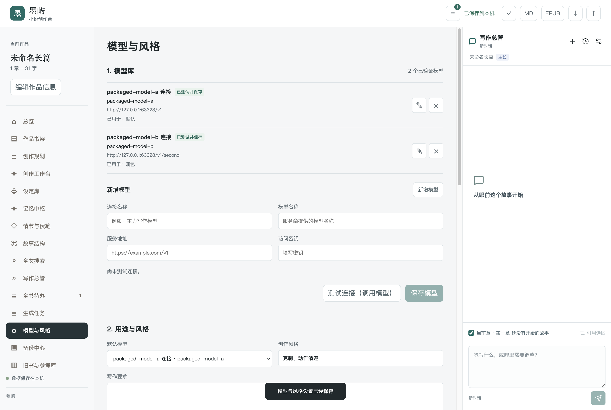

# 模型库与桌面版本机验收

本批日期为2026-10-17。范围为电脑端，包含模型连接流程与 Mac、Windows 桌面打包；不包含手机端。正文、对话、备份与连接测试使用隔离临时作品和免费本机模拟服务，没有使用作者的真实密钥或正在运行的4173、4174服务。

## 作者操作

1. 打开“模型与风格”的“模型库”，填写服务地址、访问密钥和模型名称。
2. 点击“测试连接”。通过后才能“保存模型”；修改地址、密钥或模型名称后须重新测试。
3. 打开“用途与风格”，从已测试保存的模型中选择默认模型，再按需为续写、润色、规划、记忆、审稿等用途选择不同连接。

测试通过只证明当前输入已按连接协议验证；保存前不更改正在使用的连接。测试会真实请求所填服务并可能收费，保存模型、保存用途与风格不调用模型。

已分配的连接失效后，原身份仍显示并提示处理；仅修改文风不会把它悄悄替换为默认模型。作者须重新测试保存，或明确重选、清除分配。保存失败保留原设置。已排队任务固定创建时的连接、密钥和参数，凭据变化后拒绝旧任务重试。

完整备份保存连接名称、地址与模型名称，不带密钥、测试凭证或有效验证状态。恢复后在当前电脑重新测试、保存及选择用途。旧连接兼容使用与模型库验证状态分开，不能把旧配置自动标为已测试。

写作总管仍常驻主窗口；设置页只负责配置。独立总管连接仅用于聊天，其他写作任务按用途选择执行。桌面版原先不兼容的七处浏览器填写弹窗已改为软件内填写框，保留取消、Esc、焦点恢复和稿件变化后的保护。

## 完整回归

[完整整轮03](evidence/compatibility-python311-node24-desktop-model-library-20261017-03.json)于上海时间2026-10-17 20:39:14至20:53:18执行完，退出码0：

| 检查 | 结果 |
| --- | --- |
| 全部执行项 | 136/136 |
| Python专项 | 78组通过 |
| JavaScript语法 | 34项通过 |
| 电脑浏览器 | 20组、269个场景通过 |
| 其他检查 | Python环境与语法、固定评测、编辑器合并通过 |
| 运行前后源码 | 163份逐文件SHA256一致 |
| 公开附件 | 116份逐文件SHA256匹配，含31份JSON、85张截图 |

模型设置17场景、总管设置4场景、导出理由7场景、工作台范围26场景均纳入该整轮，不重复加总。旧01、02中断轮保留本地原件，不计作完整通过。测试完成后相关测试、浏览器和临时服务进程已退出。

## 实际安装包

[打包本机证据](evidence/desktop-packaging-local-20261017.json)记录独立于浏览器整轮的 Mac arm64 验收：

| 检查对象 | 结果 |
| --- | --- |
| 最终应用内置服务 | 15/15 |
| 真实应用窗口 | 10/10 |
| 从DMG复制安装后的应用 | 10/10，挂载与临时文件清理成功 |
| 真实应用模型库 | 8/8，仅6次免费本机调用，收费与页面错误均0 |
| 桌面运行边界 | 5/5 |
| 独立打包检查 | 543文件、14链接与ZIP逐项一致；DMG完整性、临时签名结构通过 |

真实窗口检查包含正文保存与重启恢复、持续聊天草稿、1100/1280/1440宽度、剪贴板、四种导出、未保存退出取消、单实例以及退出时关闭自有服务。模型库检查覆盖两个连接先测试再保存、用途分配、输入变化撤销资格、重测失败保留旧配置，以及失效分配不静默回退。

本机包为 `Moyu-0.1.0-mac-arm64.dmg` 和同名ZIP。对应SHA256在打包证据中保留，仅指本机产物；后续GitHub原生构建会生成自己的文件及校验值，不混用。

## 发布与边界

本机验收完成后才提交和推送。GitHub分别在 Apple 芯片 Mac、Intel Mac 与 Windows x64 原生环境构建、测试内置服务、运行真实窗口及安装检查。版本标签必须与 `package.json` 相同；三个平台均通过，核对六个安装文件和三个SHA256校验文件后才创建正式下载。实际远程结果按对应提交另行记录。

作品保存在 Mac 的 `~/Library/Application Support/Moyu/` 或 Windows 的 `%APPDATA%\Moyu\`，应用菜单可打开作品数据文件夹。已有浏览器版资料通过完整作品备份导入；安装包不附带作者原稿、数据库或密钥。

当前 Mac 包最低系统版本为macOS 15，只有临时签名，未做Apple公证；Windows没有发行者签名。系统开发者或发布者提示、Intel与Windows实际原生验收、真实模型协议与文学效果须分别判断。本轮工程通过不证明文学质量已达第一梯队。
