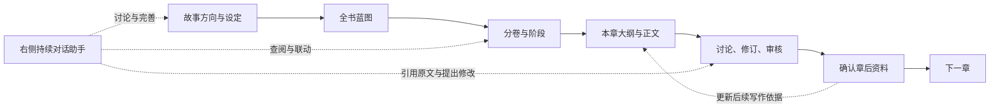

# NovelForge 写作流程与界面研究

研究日期：2026-10-16，上海时间。范围：电脑端作者流程、主工作区、灵感助手与正文修改。

## 结论

NovelForge 最值得学习的是：把设定、大纲、章节和相关资料组织为相互关联的创作对象，让作者在同一个工作区内与助手持续合作。作者确认的规划能够展开为下一层结构，当前内容可以直接带进讨论，修改建议能够回到正文处理。

研究阶段确认的改版方向是：**主界面默认提供独立、持续的聊天区，写作总管围绕作者正在处理的内容协调功能。** 研究开始时的“任务 / 候选 / 依据”长栏仍然要求作者选择任务、填写要求、查找结果，不能代替这条协作路径。连接地址、密钥和高级参数应进入设置。后续本机实现的范围单列于第六节，不能用研究截图或源码阅读代替产品验收。

## 版本和实际研究范围

- 2026-10-16 重新请求官方 GitHub `commits/main`，返回 `a485814411546b3980df0a1696a0fb6a043d56ce`，提交日期为 2026-09-23，合并说明为 v0.9.8。前端包版本同为 0.9.8。
- 通过官方 Git tree 核对本机公开源码快照：README、包版本、许可证、编辑工作区与三个编辑器/助手组件、卡型定义、四份创作工作流及 42 张 README 图片，共 54 份文件的 Git blob 指纹全部一致。
- 主代理直接查看了 README 的 image-2、3、8、9、20、27、28、29 共八张界面图，并阅读对应实现；两名代理分别追踪界面与创作流程，一名代理复核助手实际操作和确认边界。
- README 截图包含历史界面，不能据此声称全部反映 v0.9.8 的运行画面。下面用固定版源码校正截图差异。
- 未安装或运行上游完整应用，未进行真实模型调用，没有文学质量、长篇稳定性或作者效率实测。本机快照没有已安装的前后端运行依赖或构建产物。
- 最初的上游研究阶段只新增这份文档，没有修改墨屿产品代码、服务配置、作品数据或密钥；研究结束后的墨屿实现另见第六节。

## 一、它怎样带作者写完一章

默认推荐流程使用“雪花创作法”，即从一句话逐步展开到完整故事和卷章。新建时也可选择空白项目，不强制采用该模板。[N1][N2]

| 阶段 | 作者主要操作 | 系统接续的内容 | 研究依据 |
| --- | --- | --- | --- |
| 创建作品 | 输入名称，选择空白或初始化模板 | 雪花模板创建标签、金手指、一句话梗概、故事大纲、世界观和核心蓝图六张初始卡 | `ProjectCreateDialog.vue:11`；`项目创建·雪花创作法.wf:5` |
| 确定故事方向 | 逐步填写或生成梗概、大纲、世界观 | 后一阶段的生成材料引用前面的设定，避免反复手动粘贴 | `card_types.py:180` |
| 准备全书骨架 | 编辑核心蓝图中的卷数、角色和场景 | 保存蓝图触发工作流，创建或更新分卷大纲、角色卡和场景卡 | `核心蓝图.wf:6` |
| 展开一卷 | 完善分卷主辅线、阶段数量和卷末状态 | 保存分卷创建阶段大纲、写作指南，以及本卷新增角色和场景 | `分卷大纲.wf:6` |
| 落到具体章节 | 完善阶段概述、章节范围、章纲列表及参与实体 | 保存阶段后创建章纲和正文卡，正文卡带卷、阶段、章号和参与实体 | `阶段大纲.wf:6` |
| 写正文 | 打开本章正文，手写或续写 | 按本章参与实体和规划组织材料，引用前章原文、本章章纲、下一章章纲和写作指南 | `card_types.py:231` |
| 讨论和修订 | 向右侧助手追问，或选中原文快速编辑/引用 | 助手读取相关内容并可使用工具；正文批量建议在原编辑器中逐条比较、接受或拒绝 | `CodeMirrorEditor.vue:169,191,2768,4203` |
| 审核和章后整理 | 查看审核草稿、提取人物动态及关系等 | 审核草稿可确认保存为结果卡；提取结果可以修改后确认写入对应资料 | `CodeMirrorEditor.vue:251,3448,3475` |
| 继续下一章 | 打开下一章正文 | 后续写作材料可消费更新后的相关实体状态及前章内容 | `card_types.py:231` |

其中“创建下一层卡片”与“生成下一层内容”是两件事。保存蓝图、分卷、阶段所触发的工作流主要负责展开结构，不能据此说它已经全自动完成所有卷章创作。[N3][N4][N5]

这里的助手连线表示编辑工作区内可参与的操作，不代表它已经自动调度图中全部阶段。

## 二、界面为什么能支撑这条流程

| 区域 | 固定版实际内容 | 对作者的价值 |
| --- | --- | --- |
| 左栏 | 上半部是已有卡片类型；下半部是当前作品卡片树，支持搜索、层级展开及拖动 | 设定、卷、阶段、章纲和正文都有固定位置，能看见当前内容与整部作品的关系 |
| 中栏 | 卡片库、编辑器、关系图管理三个视图；编辑器根据选中内容显示设定表单或正文 | 在同一工作区处理不同创作内容；正文有标题、保存状态、字数、字号行距和写作工具 |
| 右栏 | 普通卡片有“助手 / 审核结果”两个页签；章节正文再加入参与实体、提取、大纲，共五个；没有选中卡片时单独显示助手 | 可以在当前内容旁讨论、查看本章资料或审核结果，减少离开当前内容的次数 |
| 聊天顶部 | 会话名称、新会话、历史、当前卡片、刷新上下文和预览 | 作者看得到正在与助手讨论什么，也能重开以前的话题 |
| 聊天中部 | 连续消息，以及实际工具执行的状态和结果 | 既能追问建议，也能知道助手实际查阅或处理了什么 |
| 聊天底部 | 可移除的引用、添加引用、输入区、发送或停止 | 输入位置稳定，引用内容可见，作者随时能补充意见 |

依据：`Editor.vue:2,159,185,206,232,1522-1539`；`AssistantPanel.vue:3,30,50,128`。页签数量由 `showRightSidebarTabs` 和 `rightSidebarTabNames` 的实际条件确定，不能只读模板中的旧注释。[N6][N7][N17]

重要的截图差异：

- image-27 展示正文旁的四个页签；固定版源码还包含“审核结果”，实际是五个。
- 模板中的“其他卡片：仅显示助手”注释只描述未进入页签分支的情况；实际选中普通卡片时会进入页签分支，显示“助手 / 审核结果”。
- image-20 是早期助手样式；固定版已有新会话和历史入口，以及独立消息列表和发送/停止主按钮。
- image-8 展示选区直接润色/扩写；固定版先提供“快速编辑”和“引用到灵感助手”两个入口。
- 中栏默认视图仍是卡片库，不能把截图中的正文状态描述为打开每个作品后的默认首屏。

## 三、真正值得采用的助手交互

### 1. 当前内容自动进入讨论

作者选中一张角色、世界观或正文卡时，编辑器更新当前卡片信息及作品结构，并将当前卡片自动加入引用。作者不必先从另一页复制内容，再解释“我在说哪一个人物”。[N6]

### 2. 引用不只是聊天里的一段文字

作者可补充整张卡片、正文片段或审核结果。正文片段携带来源卡片、字段、行范围和原文快照标识；引用有可见标签，可以移除或跳回来源。当前正文有未保存内容时，引用入口先尝试保存，失败则不继续引用。[N8][N9]

### 3. 临时生成与持续讨论承担不同职责

- 单卡生成：集中完善当前设定或大纲，字段逐步填充，作者可以继续反馈；生成对话框关闭后本次会话结束。
- 灵感助手：跨卡片持续讨论、组合引用、读取资料和使用工具；对话记录可重新打开。

这两种交互共同存在。不能把某个任务表单换成聊天气泡，就称为贯穿创作的助手。[N1][N7]

### 4. 修改能够回到作品里

助手不仅回答问题，还可通过真实工具查卡、读卡、创建或修改卡片、读取审核及提出正文修改。工具调用就是程序实际执行这些操作。标准模式采用 LangChain 的成熟 Agent 实现，另有文本工具兼容模式与纯聊天降级。[N10][N16]

正文批量建议工具只返回建议；编辑器提供原文与新文对照、上一条/下一条、接受本条/拒绝本条。作者不需要从长聊天回复中找文字并手动替换正文。[N11][N12]

### 5. 规划和记忆会被后续写作消费

上下文不只来自对话记录，还包括作品结构、当前内容、显式引用、已有设定及规划。章后确认的动态信息会更新实体资料，后续正文生成按参与实体取用。知识库因此参与实际写作，而不只是旁边的一份资料目录。[N8][N13]

## 四、借鉴时要分清的边界

这些边界只用于确定墨屿的实现要求，不是上游完整运行事故的结论。

- **编辑区助手不等于全软件后台总管。** 它主要贯穿编辑器内的各种卡片；切到书架或工作流时编辑器会卸载，助手卸载会取消当前流。工作流状态栏是另一套全局组件。[N14][N7]
- **保存聊天记录不等于可恢复执行。** 历史保存在浏览器本地缓存，按作品保存，最多 50 个会话；标准助手构建处没有配置持久检查点。墨屿仍需服务端会话保存、作品与分支隔离，以及现有任务恢复。[N15][N16]
- **确认规则不是统一的。** 正文批量建议可逐条裁决，但普通卡片创建/更新工具会先保存并标记待确认，其他直接改正文工具也同时存在。墨屿应保留正文采纳和正式事实晋升前的作者确认，不能照搬所有写入方式。[N10][N11]
- **关联资料不能保证不遗忘或不幻觉。** 代码能够证明材料怎样进入请求，不能证明模型始终正确理解这些材料；人物知情、故事时点、来源版本和真实长篇效果仍需要单独验证。

## 五、研究阶段的具体改版决定

以下是研究结束时提出的设计决定，当时尚未实施。后续实现采用了其中一部分，具体状态见第六节；本节保留目标本身，不作为功能完成清单。

1. **主工作区默认聊天。** 左侧目录/知识，中间当前内容，右侧独立聊天。聊天输入始终有固定位置；候选、任务详情和长材料按需展开。
2. **连接配置集中到设置。** 单独配置写作总管的连接地址、模型和密钥，也可明确选择沿用写作连接；主聊天不摆放参数表单。
3. **作者说目标，总管协调已有功能。** 例如“这一段人物反应太突兀”，应带入选区和角色资料，讨论问题、提出具体建议，再进入真实修订流程。
4. **开书流程渐进呈现。** 从故事想法开始，只显示当前需要确认的内容；确认后再展开卷章规划，不要求作者一开始面对全部卡型和高级选项。
5. **改稿在原位置裁决。** 聊天里的建议能定位正文并进入比较；拒绝不改稿，旧版本建议不覆盖新输入。
6. **一章完成后接续整理和下一章。** 总管串联审核、资料候选、作者确认及下一章准备，不让作者在各页之间手动搬运结果。
7. **持续对话有可靠保存。** 刷新、切功能页后继续；切作品或分支时隔离。聊天和任务随完整备份带走，密钥仍仅保存在本机私密凭据位置。

首轮验收应实际走通：**开作品 → 在旁边讨论 → 选中一段提出修改 → 比较并采纳 → 确认章后资料 → 准备下一章 → 刷新后接续。** 截图、模拟回复或孤立接口成功都不能代替这条作者流程。

## 六、研究后的墨屿本机实现

2026-10-16 继续开发时，持续对话已接入本机工作树。以下逐项依据当前实现说明范围，不将历史工作台或资料待办的整轮结果移作本版验收；完整整轮、独立复核、截图目视检查、GitHub检查和实际预览加载分别登记于[持续对话专项](../audits/2026-10-14/comprehensive/persistent-agent-chat.md)。

| 研究决定 | 本机实现与入口 | 当前边界 |
| --- | --- | --- |
| 独立持续聊天 | `index.html` 的独立聊天区与 `agent-chat.js` 提供固定输入、历史、新对话、发送和停止；任务、候选、依据在正文下方按需展开 | 普通讨论可直接回答；对话不会因为切到记忆、资料或设置页而卸载 |
| 当前正文与选区进入讨论 | 可选择带入当前章，或在原文选择后点击“引用选区”；引用展示来源和原文，可移除 | 每次最多三处引用；发送和动作确认再次核对正文版本、作品及分支，旧原文不能继续作为写入依据 |
| 聊天协调真实流程 | `moyu_agent_chat.py` 将讨论中的续写、修订、检查和规划建议交给已有写作流程；选区修订进入原章节的候选比较 | 建议先等待作者确认；多步写作仍需确认计划并启动，正文采纳、规划采用、记忆成为正式事实继续由作者决定 |
| 连接集中在设置 | `agent-settings.js` 与 `moyu_agent_settings.py` 提供沿用主写作连接或独立对话连接；主连接保存后同步总管状态 | 独立连接只用于聊天；续写、润色、规划、记忆及审稿继续使用主写作连接；保存不调用模型，实测连接会真实调用并共用每日额度 |
| 可靠保存与隔离 | 会话、回合、建议与任务关联保存在 SQLite，按作品和分支读取；刷新、服务重启后回读原记录 | 执行或用量未知不自动重发；完整备份包含聊天历史，恢复副本中的旧对话只读；独立连接配置与密钥不进入完整备份 |
| 渐进开书与章后接续 | 保留现有开书与下一章入口；对话可打开规划、正文、记忆和审稿，也可确认启动规划、续写、修订与章后检查 | 尚未把开书、逐条事实确认和下一章建立全部变为同一聊天中的自动编排，也没有多处改稿建议逐条裁决 |

专项回归入口为 `tests/agent_chat_fixtures.py`、`tests/agent_settings_fixtures.py`，以及聊天交互、真实服务作者流程和设置联动三套电脑浏览器检查。聊天交互专项用受控接口验证页面；真实服务专项通过真实聊天/写作接口和免费本机模拟模型验证讨论、确认、生成、比较、采纳、记忆与审稿、旧建议拒绝、停止、重启和作品隔离。它们不构成真实模型文学质量、完整开书到全书完稿或第一梯队证据。

[04完整整轮](../audits/2026-10-14/comprehensive/evidence/compatibility-python311-node24-agent-chat-release-20261016-04.json)在上海2026-10-16 18:11:11.241至18:24:03.948通过124个执行项，19套电脑浏览器共241个场景，139份源码前后相同；28份JSON与72张合成数据截图共100份附件指纹逐份匹配。[独立复核](../audits/2026-10-14/comprehensive/evidence/agent-chat-release-independent-review-20261016.json)已对应全部原日志、源码和附件；[最终界面核对](../audits/2026-10-14/comprehensive/persistent-agent-chat-visual-review-20261016.md)逐张打开12张04原生截图，尺寸与指纹全部匹配，可见区域未发现阻断主要操作的新增遮挡或栏间重叠；未进入截图的底部控件和用途表数据行不算目视通过。01失败、02通过后发现的聊天待办覆盖缺口及03超时失败均保留；04不覆盖这些历史记录，本次实际提交的GitHub检查仍待实际核对。

[本机04重启](../audits/2026-10-14/comprehensive/evidence/local-persistent-agent-chat-final-service-20261016.json)核对实际启动身份和139份来源；[页面资源](../audits/2026-10-14/comprehensive/evidence/local-persistent-agent-chat-final-resources-20261016.json)14次GET覆盖13份文件，与04逐份匹配；[最终三尺寸只读复核](../audits/2026-10-14/comprehensive/evidence/local-persistent-agent-chat-final-preview-20261016.json)155项断言全部通过，129次GET，没有写入、外联、发消息或连接实测。原65张表保持，预览原68张表仅新增四张预期空表至72张，浏览器前后内容和结构保持。预览远程模型未配置，本批新增收费调用0；私人原稿、数据库和截图不发布。这些结果不证明真实远程模型可用、完整Obsidian双向同步或文学第一梯队。

这次借鉴采用产品交互和流程概念，墨屿独立实现了会话保存、动作确认与已有任务对接；没有引入 NovelForge 的任意卡片工具、文本工具兼容层或上游提示词。与另外六个项目的固定版本比较仍见[七项目研究](novel-workbench-comparison-2026-10-15.md)。

## 固定来源

以下链接全部绑定同一提交，避免上游更新后界面与代码混用。研究产品概念和交互，独立实现；不复制上游源码、提示词或品牌素材。固定版根许可证为 AGPL-3.0。

- [N1：README 创作流程及生成/助手区别][N1]
- [N2：新建作品与可选模板][N2]
- [N3：保存核心蓝图后展开结构][N3]
- [N4：分卷展开阶段与写作指南][N4]
- [N5：阶段展开章纲与正文][N5]
- [N6：编辑工作区与当前内容变化][N6]
- [N7：持续助手界面][N7]
- [N8：实际请求的上下文组织][N8]
- [N9：选区引用及正文编辑][N9]
- [N10：助手实际工具集合][N10]
- [N11：正文建议工具][N11]
- [N12：逐条接受与拒绝][N12]
- [N13：生成材料和参与实体规则][N13]
- [N14：全应用外壳][N14]
- [N15：会话历史保存][N15]
- [N16：标准 Agent 构建][N16]
- [N17：普通卡片与正文实际页签条件][N17]
- 界面图索引：[正文工作区](https://github.com/RhythmicWave/NovelForge/blob/a485814411546b3980df0a1696a0fb6a043d56ce/docImgs/README/image-27.png)、[右侧持续聊天](https://github.com/RhythmicWave/NovelForge/blob/a485814411546b3980df0a1696a0fb6a043d56ce/docImgs/README/image-20.png)、[单卡开始生成](https://github.com/RhythmicWave/NovelForge/blob/a485814411546b3980df0a1696a0fb6a043d56ce/docImgs/README/image-28.png)、[生成后反馈与保存](https://github.com/RhythmicWave/NovelForge/blob/a485814411546b3980df0a1696a0fb6a043d56ce/docImgs/README/image-29.png)。

[N1]: https://github.com/RhythmicWave/NovelForge/blob/a485814411546b3980df0a1696a0fb6a043d56ce/README.md#L546
[N2]: https://github.com/RhythmicWave/NovelForge/blob/a485814411546b3980df0a1696a0fb6a043d56ce/frontend/src/renderer/src/components/ProjectCreateDialog.vue#L11
[N3]: https://github.com/RhythmicWave/NovelForge/blob/a485814411546b3980df0a1696a0fb6a043d56ce/backend/app/bootstrap/workflows/核心蓝图.wf
[N4]: https://github.com/RhythmicWave/NovelForge/blob/a485814411546b3980df0a1696a0fb6a043d56ce/backend/app/bootstrap/workflows/分卷大纲.wf
[N5]: https://github.com/RhythmicWave/NovelForge/blob/a485814411546b3980df0a1696a0fb6a043d56ce/backend/app/bootstrap/workflows/阶段大纲.wf
[N6]: https://github.com/RhythmicWave/NovelForge/blob/a485814411546b3980df0a1696a0fb6a043d56ce/frontend/src/renderer/src/views/Editor.vue#L159
[N7]: https://github.com/RhythmicWave/NovelForge/blob/a485814411546b3980df0a1696a0fb6a043d56ce/frontend/src/renderer/src/components/assistants/AssistantPanel.vue#L1
[N8]: https://github.com/RhythmicWave/NovelForge/blob/a485814411546b3980df0a1696a0fb6a043d56ce/frontend/src/renderer/src/composables/useAssistantRequestBuilder.ts#L61
[N9]: https://github.com/RhythmicWave/NovelForge/blob/a485814411546b3980df0a1696a0fb6a043d56ce/frontend/src/renderer/src/components/editors/CodeMirrorEditor.vue#L2768
[N10]: https://github.com/RhythmicWave/NovelForge/blob/a485814411546b3980df0a1696a0fb6a043d56ce/backend/app/services/ai/assistant/tools.py#L1278
[N11]: https://github.com/RhythmicWave/NovelForge/blob/a485814411546b3980df0a1696a0fb6a043d56ce/backend/app/services/ai/assistant/tools.py#L603
[N12]: https://github.com/RhythmicWave/NovelForge/blob/a485814411546b3980df0a1696a0fb6a043d56ce/frontend/src/renderer/src/components/editors/CodeMirrorEditor.vue#L4203
[N13]: https://github.com/RhythmicWave/NovelForge/blob/a485814411546b3980df0a1696a0fb6a043d56ce/backend/app/bootstrap/card_types.py#L231
[N14]: https://github.com/RhythmicWave/NovelForge/blob/a485814411546b3980df0a1696a0fb6a043d56ce/frontend/src/renderer/src/App.vue#L101
[N15]: https://github.com/RhythmicWave/NovelForge/blob/a485814411546b3980df0a1696a0fb6a043d56ce/frontend/src/renderer/src/composables/useAssistantSessionHistory.ts#L88
[N16]: https://github.com/RhythmicWave/NovelForge/blob/a485814411546b3980df0a1696a0fb6a043d56ce/backend/app/services/ai/core/agent_builder.py#L33
[N17]: https://github.com/RhythmicWave/NovelForge/blob/a485814411546b3980df0a1696a0fb6a043d56ce/frontend/src/renderer/src/views/Editor.vue#L1522
